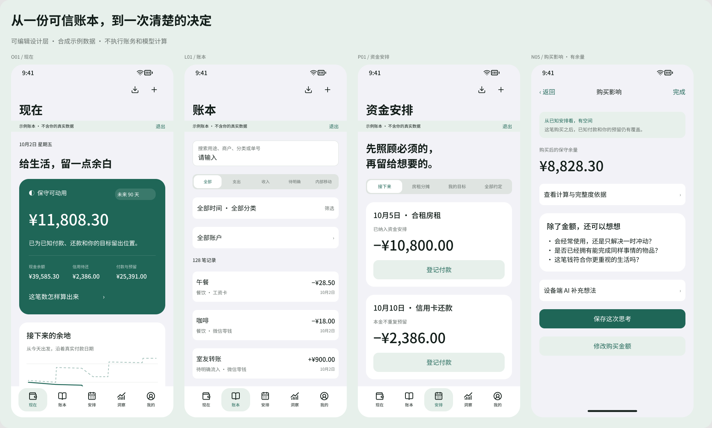

# 余白全动作 UI / UX 画布

制作日期：2026-10-02。用户本轮要求：「在 codex 的 figma 中，把每个动作的 UI/UX 画出来，另外告诉我，你参考了哪些 UI 和组件库」。本轮交付设计画布、组件、状态与动作索引，没有修改应用业务或界面源码。

## 当前版本浏览稿（2026-10-08）

本轮用户要求先将当前产品画完整详细，在Figma内按页面讨论，暂不修改产品。新稿保留在同一文件的新页面，原2026-10-02稿保留。

- [直接浏览目录](https://www.figma.com/design/vIJH4tq6ZMNOJeRzUsI2Z7?node-id=40-6983)
- [互动预览](https://www.figma.com/proto/vIJH4tq6ZMNOJeRzUsI2Z7/Yubai?node-id=40-6983&starting-point-node-id=40%3A6983&scaling=scale-down&content-scaling=fixed)
- [五个主页面总览](https://www.figma.com/design/vIJH4tq6ZMNOJeRzUsI2Z7?node-id=47-3613)
- [三步使用说明](https://www.figma.com/design/vIJH4tq6ZMNOJeRzUsI2Z7?node-id=41-3613)
- [Mac完整画板](https://www.figma.com/design/vIJH4tq6ZMNOJeRzUsI2Z7?node-id=24-3615)

包含111个手机页面/状态与11个Mac画板。手机747条、Mac95条原型连接独立读回均指向存在的对应画板；没有空画板、缺失字体标记。结构检查不等于实际交互验收。

校准了当前五个主页面：账本连续列表与搜索、安排的标题/金额横排、洞察收入/退款并列与分类环图/每日柱形、设置同页资金偏好。保留5000和40缺少标签等当前已知问题，不将修复混入现状稿。首页新增图表提议取消；应用当前已有的预测图在本次原样映射中保留。分类明细页改进未新增，N03明确标为同页分类区的滚动阅读状态。

文字、组件、图表均为可编辑图层。唯一栅格内容是从合成账本原生截图中提取的43pt品牌图标；没有完整界面图片填充。颜色与间距复用现有变量和组件，旧页/组件保留。44个应用源码与工程文件SHA-256回读没有变化。

字体与还原边界：SF Pro/SF Pro Rounded虽列为可用，实际Figma导出为空；询问兼容偏好后，按既有稿的Noto字体与Lucide图标作明确、可恢复的默认兼容处理。Apple iOS组件库导入被拒。不是逐像素原生复刻；菜单、键盘、文件选择、认证和模型能力是固定状态表达。Mac依源码映射，未以当前Mac原生运行逐页核验。预设示例值不执行真实记账或文件操作。

已看到Figma浏览器实际呈现新目录；点击Present触发登录提示，因此未完成逐路径播放点击验收，也未代用户登录。用户先登录Figma再预览/评论；也可直接在本对话描述页面名和位置。

本轮证据与状态账本：[current-baseline-20261008](../.design-meta/figma/current-baseline-20261008/)。代表最终截图：qa-overview-final.png、qa-directory.png、qa-M04-final.png、qa-L06.png、qa-I05.png；原生截图在native/。SF字体空白与失败的本机图标测试文件是诊断证据，未用于交付。

---

## 打开与阅读

- [全动作入口与目录](https://www.figma.com/design/vIJH4tq6ZMNOJeRzUsI2Z7?node-id=13-3367)
- [关键界面预览](https://www.figma.com/design/vIJH4tq6ZMNOJeRzUsI2Z7?node-id=13-3430)
- [组件与状态](https://www.figma.com/design/vIJH4tq6ZMNOJeRzUsI2Z7?node-id=14-3613)、[颜色与排版](https://www.figma.com/design/vIJH4tq6ZMNOJeRzUsI2Z7?node-id=14-3756)
- [参考与采用说明](https://www.figma.com/design/vIJH4tq6ZMNOJeRzUsI2Z7?node-id=14-3816)
- [Mac 主页面与共用表单](https://www.figma.com/design/vIJH4tq6ZMNOJeRzUsI2Z7?node-id=10-3368)
- [逐动作索引](UI-UX-ACTIONS.md)

在 Codex 的 Figma 内已打开这个文件。第一页面顶部是目录，下方按 A/O/L/I/P/R/N/S/X/D 编号排列。手机画板为 440 × 956，长表单保留滚动内容。Figma 的 Flows 列表有目录和各业务起点，可选择起点播放。相同输入、选择器与反馈由共用控件页表达；Mac 沿用同一业务状态，另画侧栏布局和弹窗。

## 已绘制的范围

| 流程 | 界面与状态 | 覆盖内容 |
|---|---:|---|
| A 开始使用与账户 | 8 | 欢迎、开户、余额基准、账户列表、核对差额、归档与不同账户类型 |
| O 现在与资金依据 | 5 | 保守可动用、展开计算、隐藏金额、依据不足、待明确流入 |
| L 账本、记账与纠正 | 20 | 搜索筛选、空状态、明细、新建与编辑、不同资金性质、退款、转账合并、批量、回收站、取消与失败 |
| I 文件导入与截图补记 | 13 | 选文件、读取、付款账户对应、预览、重复/冲突、保存结果、格式失败、选图、OCR 后确认 |
| P 资金安排与目标 | 12 | 周期收支、新建约定、登记付款、关联已有记录、停止跟踪、目标与预留 |
| R 房租分摊 | 10 | 月收季付、每月应收、部分收款、实际付款、关联合同、修改限制与结束 |
| N 洞察与购买思考 | 12 | 消费统计、用途明细、购买输入、有余量/不足、保存思考、模型等待/可用/不可用/失败 |
| S 我的与持续维护 | 20 | 预留设置、分类与规则、备份导出、恢复预览与失败、历史、整批撤销、解锁、外观、指南、损坏保护 |
| X 共用控件 | 8 | 键盘、类型、日期、分类、账户、保存与撤销反馈、周期、外观 |
| D 适配 | 3 | 深色首页、辅助字号账本与设置 |
| M Mac | 11 | 五个主页面；记账、导入、安排、房租收款、购买判断和备份弹窗 |

共 111 个 iPhone 界面与状态、11 个 Mac 画板。相似系统控件与同一反馈模式共用示意，不为每种金额或每次点击复制一套页面。每个画板下保留设计说明和来源状态；完整索引列出返回、保存及主要跳转目标。

## UI 与组件来源

| 来源 | 本项目实际采用到哪里 | 来源链接 |
|---|---|---|
| SwiftUI / Apple HIG | 应用使用原生导航、表单、sheet、菜单、文件选择；iPhone 底部导航、Mac 侧栏。HIG 是方向参考，网页正文受 JS 限制，未声称逐条核验新版细则 | [SwiftUI](https://developer.apple.com/swiftui/)、[HIG](https://developer.apple.com/design/human-interface-guidelines) |
| SF Symbols / Swift Charts | 应用里的系统图标和财务图表；当前 Figma 图表为可编辑矢量 | [SF Symbols](https://developer.apple.com/sf-symbols/)、[Swift Charts](https://developer.apple.com/documentation/charts) |
| 余白本地组件 | 从实际 `DesignSystem.swift` 和页面代码派生：按钮、输入、行、交易条目、说明、开关、tab 等；Figma 内有 14 个 UI 组件及 28 个图标组件、43 个变量、8 个文字样式 | [源码](../Sources/YubaiApp/DesignSystem.swift)、[组件画布](https://www.figma.com/design/vIJH4tq6ZMNOJeRzUsI2Z7?node-id=14-3613) |
| Lucide / Noto | 仅作为 Figma 图标和字体替代：Lucide 可编辑 SVG；Noto Sans SC 正文和金额，Noto Serif SC 欢迎标题。应用仍用 SF Symbols 与系统字体 | [Lucide 官方仓库](https://github.com/lucide-icons/lucide)、[本地 ISC 许可证](../.design-meta/figma/icons/LICENSE)、[Noto CJK](https://github.com/notofonts/noto-cjk) |
| shadcn/ui / Radix Primitives | 调研了 Web 表单、对话框、菜单和可访问性模式，作为技术路线比较；没有安装进原生应用 | [shadcn/ui](https://ui.shadcn.com/docs)、[Radix](https://www.radix-ui.com/primitives/docs/overview/introduction) |
| Expo / React Native、Flutter、Capacitor | 比较过跨平台实现路径；本次选用 SwiftUI，共享 Swift 财务核心 | [React Native 平台](https://reactnative.dev/docs/out-of-tree-platforms)、[Flutter 支持平台](https://docs.flutter.dev/reference/supported-platforms)、[Capacitor](https://capacitorjs.com/docs) |

Apple iOS / iPadOS 26 UI Kit 已在 Figma 库中检索，但导入被服务权限拒绝。没有复制其库组件来冒充复用成功；当前 Figma 使用上述本地派生组件。因此这份稿是可编辑的实现映射与设计说明，字体、图标和部分系统控件并非原生截图的逐像素复刻。

## 竞品交互借鉴

| 产品 | 借鉴的具体问题 | 官方来源 |
|---|---|---|
| Actual Budget | 导入规则、可解释去重、用户纠正优先、转账两端、真实余额核对 | [规则](https://actualbudget.org/docs/budgeting/rules/)、[转账](https://actualbudget.org/docs/transactions/transfers/)、[对账](https://actualbudget.org/docs/accounts/reconciliation/) |
| YNAB | 文件导入和余额核对的流程；余白独立实现 iPhone 本机导入，不照搬其预算周期 | [文件导入](https://support.ynab.com/en_us/file-based-import-a-guide-Bkj4Sszyo) |
| 钱迹 | 微信/支付宝账单词汇，退款、还款、借还款与普通收支的区分 | [导入](https://docs.qianjiapp.com/other/import_guide2.html)、[FAQ](https://docs.qianjiapp.com/question_answer.html) |
| MoneyWiz | 按未来日期看余额的任务 | [官网](https://www.wiz.money/) |
| Monarch | 未来事件与周期安排；预测要交代假设与不确定性 | [Forecasting](https://help.monarch.com/hc/en-us/articles/48344305092244-Forecasting-in-Monarch) |
| Copilot | 清楚区分收入、普通交易与内部转账，提供筛选和明细编辑 | [交易类型](https://help.copilot.money/en/articles/3971267-transaction-types)、[交易页](https://help.copilot.money/en/articles/9554412-transactions-tab-overview) |

这些是官方文档和官网研究，没有安装实测竞品，也没有照搬它们的完整视觉。查询过程、来源限制与工程判断见 [原研究](../.scratch/yubai-product/research/2026-10-01-product-and-ui.md)。

## 验证与边界

- Figma 独立读回确认 122 个业务画板、2,553 个文字层、1,248 个组件实例。手机 746 条、Mac 97 条 reaction 记录均指向存在的顶层画板或返回动作；没有无效目标。统计不包含封面预览的副本。
- 所有业务画板均没有整页图片填充，内容由文字、组件与矢量构成。读回未发现缺失字体和横向溢出。111 个手机滚动容器、17 个 Mac 页面/弹窗滚动容器已配置。
- 已观察开户、首页、账本、导入映射、安排、房租、购买判断、恢复预览、深色、大字号、Mac、封面与组件的代表截图；修正了中文换行、Mac 右侧金额和图标缩放问题。没有将结构检查等同全状态视觉验收。
- Codex 内嵌 Figma 已显示文件名和 Flows 列表；其播放菜单遮挡目标按钮，实际逐路径点击尚未完成。本轮不声称所有原型路径经过人工操作验收。
- 原型采用固定合成金额与输入。文件选择、OCR、设备认证和模型生成只表达状态；不读取用户财务、不执行转账、不调用实际模型。
- 画布不是本轮重新实现的应用，也不是应用真机验收结果；原生行为与安装边界仍以 [应用验证报告](VALIDATION.md) 为准。视觉尚待用户实际审阅；不存在自动双向同步。

构建状态与读回记录保存在 [Figma 工作目录](../.design-meta/figma/)，后续编辑应保留节点 ID 和逐动作编号，避免重建另一份失联画布。
