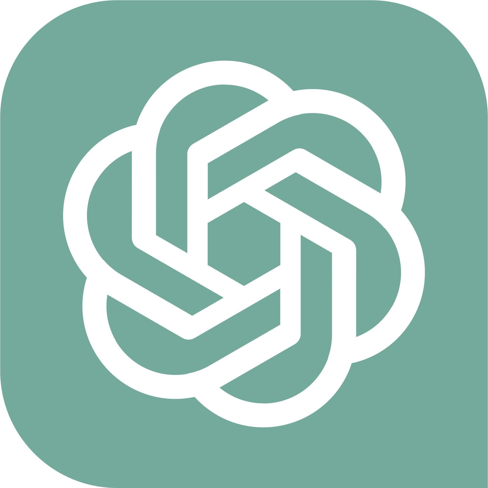
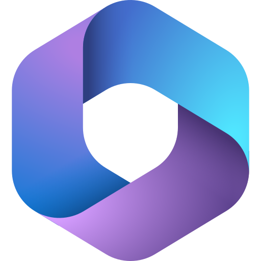
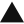
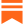
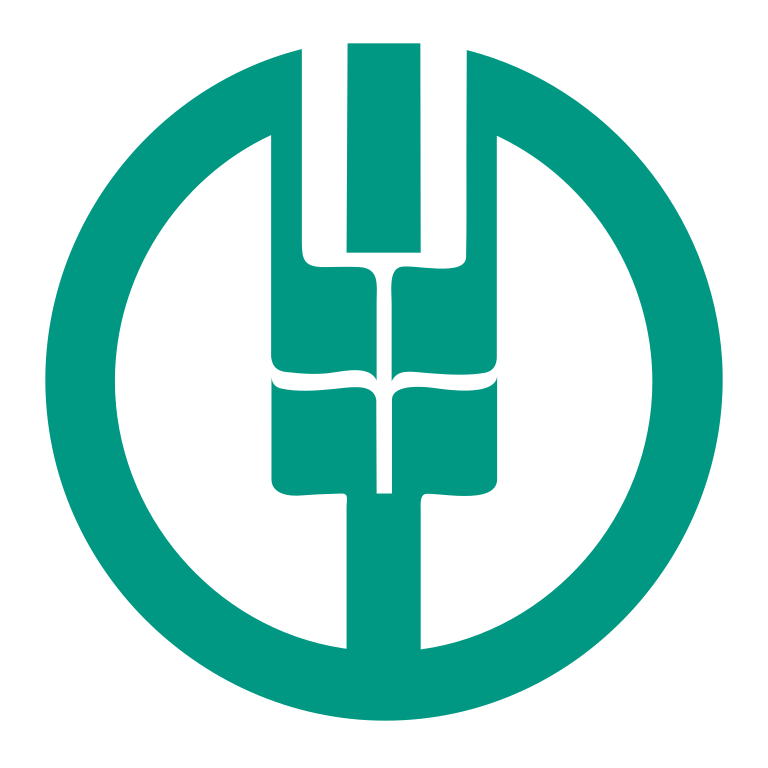
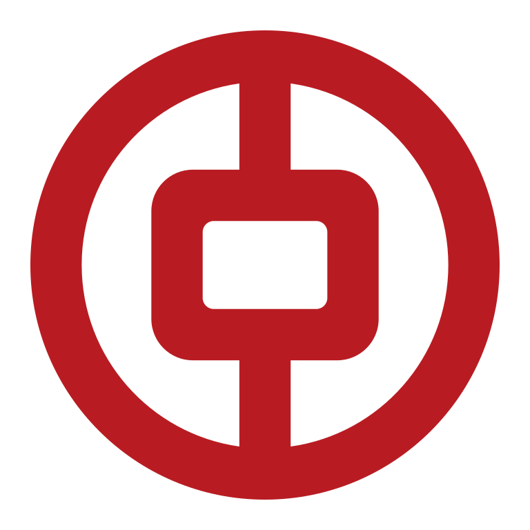
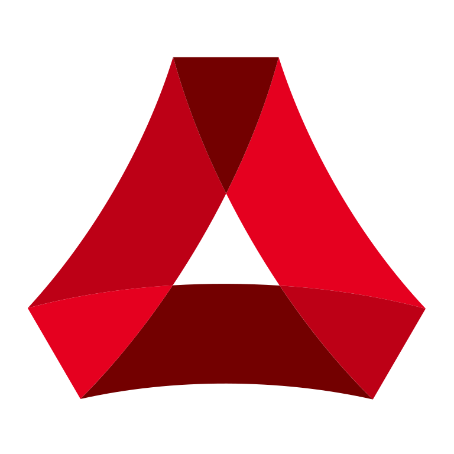
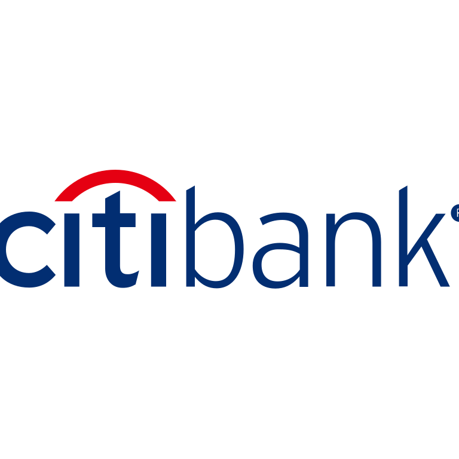

# 品牌与订阅服务图标库（Brand & Subscription Icons）

用于「会回来的账单」（固定收付 / 周期订阅 / 月历视图）的品牌矢量图标库，共收录 **301** 个国内外常用服务与品牌图标（国内品牌 **135** 个、海外及全球品牌 **166** 个）。

## 目录结构

- [`svg/`](svg/)：独立的标准 SVG 矢量图标（`<slug>.svg`），内置品牌代表色，可直接用于设计稿或客户端渲染。
- [`catalog.json`](catalog.json)：图标索引元数据，包含中英文名称、分类、地区（`cn` / `global`）、品牌主色（`hex`）以及用于账单名称自动匹配的关键词列表（`keywords`）。

## 分类统计

| 分类 ID | 分类名称 | 数量 |
| :--- | :--- | ---: |
| `ai` | AI 与大模型 | 62 |
| `productivity` | 效率、设计与办公软件 | 47 |
| `cloud_dev` | 开发者与云服务 | 26 |
| `ecommerce` | 电商、独立站与商业工具 | 30 |
| `media` | 流媒体影音、音乐与阅读 | 30 |
| `gaming_social` | 社交与游戏订阅 | 31 |
| `finance` | 银行、支付与金融 | 33 |
| `utilities_mobility` | 运营商、出行与生活缴费 | 16 |
| `lifestyle` | 餐饮、硬件与消费品牌 | 26 |

## 图标清单

### AI 与大模型（62）

| 预览 | Slug | 中文名称 | 英文名称 | 地区 | 品牌主色 | 匹配关键词 |
| :---: | :--- | :--- | :--- | :---: | :--- | :--- |
|  | `chatgpt` | ChatGPT | ChatGPT | 全球 | `#10A37F` | ChatGPT、OpenAI、GPT-4、ChatGPT Plus |
|  | `openai` | OpenAI | OpenAI | 全球 | `#10A37F` | OpenAI、GPT、API |
|  | `sora` | Sora | Sora | 全球 | `#0066FF` | Sora、OpenAI Sora |
|  | `claude` | Claude | Claude | 全球 | `#D97757` | Claude、Claude Pro、Claude Max、Anthropic |
|  | `claudecode` | Claude Code | Claude Code | 全球 | `#D97757` | Claude Code、Anthropic CLI |
|  | `anthropic` | Anthropic | Anthropic | 全球 | `#191919` | Anthropic、Claude API |
|  | `gemini` | Gemini | Google Gemini | 全球 | `#4E86F6` | Gemini、Google AI、Gemini Advanced、Bard |
|  | `notebooklm` | NotebookLM | NotebookLM | 全球 | `#1A73E8` | NotebookLM、Google NotebookLM |
|  | `perplexity` | Perplexity | Perplexity | 全球 | `#20808D` | Perplexity、Perplexity Pro |
|  | `midjourney` | Midjourney | Midjourney | 全球 | `#111111` | Midjourney、MJ |
|  | `cursor` | Cursor | Cursor | 全球 | `#111111` | Cursor、Cursor Pro |
|  | `windsurf` | Windsurf | Windsurf | 全球 | `#09B6A2` | Windsurf、Codeium |
|  | `github-copilot` | GitHub Copilot | GitHub Copilot | 全球 | `#000000` | GitHub Copilot、Copilot |
|  | `grok` | Grok | Grok | 全球 | `#111111` | Grok、SuperGrok、xAI |
|  | `xai` | xAI | xAI | 全球 | `#111111` | xAI、Grok API |
|  | `poe` | Poe | Poe | 全球 | `#5B4AE6` | Poe、Quora Poe |
|  | `elevenlabs` | ElevenLabs | ElevenLabs | 全球 | `#111111` | ElevenLabs、AI配音、TTS |
|  | `runway` | Runway | Runway | 全球 | `#111111` | Runway、Gen-3 |
|  | `suno` | Suno | Suno | 全球 | `#FF5722` | Suno、AI音乐 |
|  | `udio` | Udio | Udio | 全球 | `#E91E63` | Udio |
|  | `flux` | Flux | Flux | 全球 | `#111111` | Flux、Black Forest Labs |
|  | `ideogram` | Ideogram | Ideogram | 全球 | `#111111` | Ideogram |
|  | `luma` | Luma | Luma Dream Machine | 全球 | `#111111` | Luma、Dream Machine |
|  | `pika` | Pika | Pika | 全球 | `#F5A623` | Pika、Pika Art |
|  | `huggingface` | Hugging Face | Hugging Face | 全球 | `#FFD21E` | Hugging Face、HF |
|  | `replicate` | Replicate | Replicate | 全球 | `#111111` | Replicate |
|  | `mistral` | Mistral AI | Mistral AI | 全球 | `#FA520F` | Mistral、Le Chat |
|  | `cohere` | Cohere | Cohere | 全球 | `#39594D` | Cohere |
|  | `ollama` | Ollama | Ollama | 全球 | `#111111` | Ollama |
|  | `openrouter` | OpenRouter | OpenRouter | 全球 | `#6366F1` | OpenRouter |
|  | `adobe-firefly` | Adobe Firefly | Adobe Firefly | 全球 | `#EB1000` | Adobe Firefly、Firefly |
|  | `v0` | v0 | v0 | 全球 | `#111111` | v0、v0.dev、Vercel v0 |
|  | `lovable` | Lovable | Lovable | 全球 | `#FF4F5A` | Lovable、lovable.dev |
|  | `manus` | Manus | Manus | 全球 | `#111111` | Manus、Manus AI |
|  | `cherrystudio` | Cherry Studio | Cherry Studio | 国内 | `#FF4D4F` | Cherry Studio |
|  | `deepseek` | 深度求索 (DeepSeek) | DeepSeek | 国内 | `#4D6BFE` | DeepSeek、深度求索、DeepSeek API |
|  | `kimi` | Kimi (月之暗面) | Kimi | 国内 | `#111111` | Kimi、月之暗面、Kimi智能助手 |
|  | `moonshot` | 月之暗面 (Moonshot) | Moonshot AI | 国内 | `#16191E` | Moonshot、月之暗面、Moonshot API |
|  | `qwen` | 通义千问 (Qwen) | Qwen | 国内 | `#615CED` | 通义千问、千问、Qwen、通义 |
|  | `doubao` | 豆包 (Doubao) | Doubao | 国内 | `#3B70FC` | 豆包、Doubao、字节豆包 |
|  | `jimeng` | 即梦 AI | Jimeng AI | 国内 | `#00C8FF` | 即梦、即梦AI、Jimeng |
|  | `trae` | Trae | Trae | 国内 | `#32F08C` | Trae、字节Trae |
|  | `zhipu` | 智谱清言 (GLM) | Zhipu AI | 国内 | `#3859FF` | 智谱、智谱清言、ChatGLM、GLM |
|  | `wenxin` | 文心一言 | ERNIE Bot | 国内 | `#2932E1` | 文心一言、百度文心、ERNIE、文心 |
|  | `hunyuan` | 腾讯混元 | Tencent Hunyuan | 国内 | `#0052D9` | 腾讯混元、混元、Hunyuan |
|  | `yuanbao` | 腾讯元宝 | Tencent Yuanbao | 国内 | `#00C896` | 腾讯元宝、元宝、Yuanbao |
|  | `spark` | 讯飞星火 | iFlytek Spark | 国内 | `#0066FF` | 讯飞星火、科大讯飞、星火大模型 |
|  | `baichuan` | 百川智能 | Baichuan AI | 国内 | `#FF6A00` | 百川、百川智能、Baichuan |
|  | `minimax` | MiniMax | MiniMax | 国内 | `#F23F5D` | MiniMax、稀宇科技 |
|  | `hailuo` | 海螺 AI | Hailuo AI | 国内 | `#635BFF` | 海螺AI、海螺、Hailuo |
|  | `kling` | 可灵 AI | Kling AI | 国内 | `#00E599` | 可灵、可灵AI、Kling、快手可灵 |
|  | `vidu` | Vidu | Vidu | 国内 | `#2563EB` | Vidu、生数科技 |
|  | `stepfun` | 阶跃星辰 (跃问) | StepFun | 国内 | `#0066FF` | 阶跃星辰、跃问、StepFun |
|  | `yi` | 零一万物 | 01.AI (Yi) | 国内 | `#00474F` | 零一万物、万知、Yi、01.AI |
|  | `coze` | 扣子 (Coze) | Coze | 国内 | `#4E40E5` | 扣子、Coze |
|  | `dify` | Dify | Dify | 国内 | `#0033FF` | Dify |
|  | `siliconcloud` | 硅基流动 (SiliconCloud) | SiliconFlow | 国内 | `#7C3AED` | 硅基流动、SiliconCloud、SiliconFlow |
|  | `volcengine` | 火山引擎 (火山方舟) | Volcengine | 国内 | `#1664FF` | 火山引擎、火山方舟、Volcengine |
|  | `sensenova` | 商汤日日新 | SenseNova | 国内 | `#5C33F6` | 商汤、日日新、SenseNova |
|  | `modelscope` | 魔搭社区 (ModelScope) | ModelScope | 国内 | `#624AFF` | 魔搭、ModelScope |
|  | `bailian` | 阿里云百炼 | Alibaba Cloud Bailian | 国内 | `#615CED` | 百炼、阿里云百炼、DashScope |
|  | `skywork` | 天工 AI | Skywork | 国内 | `#2B5AED` | 天工、天工AI、昆仑万维 |

### 效率、设计与办公软件（47）

| 预览 | Slug | 中文名称 | 英文名称 | 地区 | 品牌主色 | 匹配关键词 |
| :---: | :--- | :--- | :--- | :---: | :--- | :--- |
|  | `apple` | Apple (Apple One) | Apple | 全球 | `#111111` | Apple、苹果、Apple One、AppleCare+ |
|  | `icloud` | iCloud+ | iCloud+ | 全球 | `#3693F3` | iCloud、iCloud+、云空间 |
|  | `app-store` | App Store | App Store | 全球 | `#0D96F6` | App Store、应用商店、苹果订阅 |
|  | `notion` | Notion | Notion | 全球 | `#111111` | Notion、Notion AI |
|  | `figma` | Figma | Figma | 全球 | `#F24E1E` | Figma、FigJam |
|  | `adobe` | Adobe (Creative Cloud) | Adobe Creative Cloud | 全球 | `#FA0F00` | Adobe、Creative Cloud、Photoshop、Lightroom |
|  | `capcut` | 剪映 (CapCut) | CapCut | 国内 | `#111111` | 剪映、剪映SVIP、CapCut |
|  | `slack` | Slack | Slack | 全球 | `#4A154B` | Slack |
|  | `zoom` | Zoom | Zoom | 全球 | `#0B5CFF` | Zoom、Zoom视频会议 |
|  | `microsoft` | 微软 (Microsoft) | Microsoft | 全球 | `#00A4EF` | Microsoft、微软 |
|  | `microsoft-365` | Microsoft 365 (Office) | Microsoft 365 | 全球 | `#D83B01` | Microsoft 365、Office 365、Office、OneDrive |
|  | `google` | Google | Google | 全球 | `#4285F4` | Google、谷歌 |
|  | `google-drive` | Google One (云端硬盘) | Google One / Drive | 全球 | `#4285F4` | Google One、Google Drive、谷歌云盘 |
|  | `dropbox` | Dropbox | Dropbox | 全球 | `#0061FF` | Dropbox |
|  | `1password` | 1Password | 1Password | 全球 | `#3B66BC` | 1Password |
|  | `bitwarden` | Bitwarden | Bitwarden | 全球 | `#175DDC` | Bitwarden |
|  | `setapp` | Setapp | Setapp | 全球 | `#E6884B` | Setapp |
|  | `raycast` | Raycast | Raycast | 全球 | `#FF6363` | Raycast、Raycast Pro |
|  | `linear` | Linear | Linear | 全球 | `#5E6AD2` | Linear |
|  | `obsidian` | Obsidian | Obsidian | 全球 | `#7C3AED` | Obsidian、Obsidian Sync |
|  | `evernote` | 印象笔记 (Evernote) | Evernote | 全球 | `#00A82D` | 印象笔记、Evernote |
|  | `todoist` | Todoist | Todoist | 全球 | `#E44332` | Todoist |
|  | `ticktick` | 滴答清单 (TickTick) | TickTick | 国内 | `#4772FA` | 滴答清单、TickTick |
|  | `canva` | 可画 (Canva) | Canva | 全球 | `#00C4CC` | Canva、可画、Canva Pro |
|  | `framer` | Framer | Framer | 全球 | `#0055FF` | Framer |
|  | `webflow` | Webflow | Webflow | 全球 | `#146EF5` | Webflow |
|  | `sketch` | Sketch | Sketch | 全球 | `#F7B500` | Sketch |
|  | `miro` | Miro | Miro | 全球 | `#050038` | Miro |
|  | `airtable` | Airtable | Airtable | 全球 | `#18BFFF` | Airtable |
|  | `zapier` | Zapier | Zapier | 全球 | `#FF4F00` | Zapier |
|  | `n8n` | n8n | n8n | 全球 | `#EA4B71` | n8n |
|  | `make` | Make | Make | 全球 | `#6D00CC` | Make、Integromat |
|  | `deepl` | DeepL 翻译 | DeepL | 全球 | `#0F2B46` | DeepL、DeepL Pro |
|  | `grammarly` | Grammarly | Grammarly | 全球 | `#15C39A` | Grammarly |
|  | `duolingo` | 多邻国 (Duolingo) | Duolingo | 全球 | `#58CC02` | 多邻国、Duolingo、Super Duolingo |
|  | `arc` | Arc | Arc Browser | 全球 | `#FC3867` | Arc |
|  | `tailscale` | Tailscale | Tailscale | 全球 | `#242424` | Tailscale |
|  | `plex` | Plex Pass | Plex | 全球 | `#E5A00D` | Plex、Plex Pass |
|  | `feishu` | 飞书 (Feishu) | Feishu / Lark | 国内 | `#00D6B9` | 飞书、Lark、Feishu |
|  | `dingtalk` | 钉钉 (DingTalk) | DingTalk | 国内 | `#0089FF` | 钉钉、DingTalk |
|  | `wecom` | 企业微信 | WeCom | 国内 | `#2B7BF6` | 企业微信、企微、WeCom |
|  | `wps` | WPS Office (超级会员) | WPS Office | 国内 | `#EA3E23` | WPS、WPS会员、WPS超级会员、金山文档 |
|  | `yuque` | 语雀 (Yuque) | Yuque | 国内 | `#00B96B` | 语雀、Yuque |
|  | `siyuan` | 思源笔记 | SiYuan | 国内 | `#D23F31` | 思源笔记、SiYuan |
|  | `baidu-wangpan` | 百度网盘 (SVIP) | Baidu Wangpan | 国内 | `#06A7FF` | 百度网盘、百度云、网盘SVIP |
|  | `aliyun-drive` | 阿里云盘 | Aliyun Drive | 国内 | `#636BFF` | 阿里云盘、阿里网盘 |
|  | `quark` | 夸克网盘 (Quark) | Quark | 国内 | `#4E6EF2` | 夸克、夸克网盘、Quark |

### 开发者与云服务（26）

| 预览 | Slug | 中文名称 | 英文名称 | 地区 | 品牌主色 | 匹配关键词 |
| :---: | :--- | :--- | :--- | :---: | :--- | :--- |
|  | `github` | GitHub | GitHub | 全球 | `#181717` | GitHub、GitHub Pro |
|  | `gitlab` | GitLab | GitLab | 全球 | `#FC6D26` | GitLab |
|  | `gitee` | Gitee (码云) | Gitee | 国内 | `#C71D23` | Gitee、码云 |
|  | `vercel` | Vercel | Vercel | 全球 | `#111111` | Vercel、Vercel Pro |
|  | `cloudflare` | Cloudflare | Cloudflare | 全球 | `#F38020` | Cloudflare、域名续费、R2 |
|  | `netlify` | Netlify | Netlify | 全球 | `#00C7B7` | Netlify |
|  | `digitalocean` | DigitalOcean | DigitalOcean | 全球 | `#0080FF` | DigitalOcean |
|  | `aws` | AWS (亚马逊云) | Amazon Web Services | 全球 | `#FF9900` | AWS、Amazon Web Services、亚马逊云 |
|  | `google-cloud` | Google Cloud (GCP) | Google Cloud | 全球 | `#4285F4` | Google Cloud、GCP |
|  | `azure` | Microsoft Azure | Microsoft Azure | 全球 | `#0078D4` | Azure、Microsoft Azure |
|  | `supabase` | Supabase | Supabase | 全球 | `#3ECF8E` | Supabase |
|  | `firebase` | Firebase | Firebase | 全球 | `#DD2C00` | Firebase |
|  | `railway` | Railway | Railway | 全球 | `#0B0D0E` | Railway |
|  | `render` | Render | Render | 全球 | `#46E3B7` | Render |
|  | `flydotio` | Fly.io | Fly.io | 全球 | `#7B3BE2` | Fly.io |
|  | `zeabur` | Zeabur | Zeabur | 国内 | `#6366F1` | Zeabur |
|  | `docker` | Docker | Docker | 全球 | `#2496ED` | Docker、Docker Hub |
|  | `jetbrains` | JetBrains (All Products Pack) | JetBrains | 全球 | `#111111` | JetBrains、IntelliJ、PyCharm、WebStorm |
|  | `replit` | Replit | Replit | 全球 | `#F26207` | Replit、Replit Core |
|  | `postman` | Postman | Postman | 全球 | `#FF6C37` | Postman |
|  | `npm` | npm | npm | 全球 | `#CB3837` | npm |
|  | `alibaba-cloud` | 阿里云 (Alibaba Cloud) | Alibaba Cloud | 国内 | `#FF6A00` | 阿里云、ECS、OSS、Alibaba Cloud |
|  | `tencent-cloud` | 腾讯云 (Tencent Cloud) | Tencent Cloud | 国内 | `#0052D9` | 腾讯云、轻量应用服务器、DNSPod、Tencent Cloud |
|  | `huawei-cloud` | 华为云 (Huawei Cloud) | Huawei Cloud | 国内 | `#E60012` | 华为云、Huawei Cloud |
|  | `baidu-cloud` | 百度智能云 | Baidu AI Cloud | 国内 | `#1068E9` | 百度智能云、百度云 |
|  | `qiniu` | 七牛云 | Qiniu Cloud | 国内 | `#07BEFF` | 七牛云、Qiniu |

### 电商、独立站与商业工具（30）

| 预览 | Slug | 中文名称 | 英文名称 | 地区 | 品牌主色 | 匹配关键词 |
| :---: | :--- | :--- | :--- | :---: | :--- | :--- |
|  | `shopify` | Shopify | Shopify | 全球 | `#7AB55C` | Shopify、独立站 |
|  | `stripe` | Stripe | Stripe | 全球 | `#635BFF` | Stripe |
|  | `paypal` | PayPal | PayPal | 全球 | `#00457C` | PayPal、贝宝 |
|  | `wise` | Wise | Wise | 全球 | `#9FE870` | Wise、TransferWise |
|  | `revolut` | Revolut | Revolut | 全球 | `#191C1F` | Revolut |
|  | `patreon` | Patreon | Patreon | 全球 | `#F96854` | Patreon |
|  | `substack` | Substack | Substack | 全球 | `#FF6719` | Substack |
|  | `gumroad` | Gumroad | Gumroad | 全球 | `#FF90E8` | Gumroad |
|  | `wordpress` | WordPress | WordPress | 全球 | `#21759B` | WordPress |
|  | `squarespace` | Squarespace | Squarespace | 全球 | `#111111` | Squarespace |
|  | `wix` | Wix | Wix | 全球 | `#0C6EFC` | Wix |
|  | `godaddy` | GoDaddy | GoDaddy | 全球 | `#1BDBDB` | GoDaddy |
|  | `namecheap` | Namecheap | Namecheap | 全球 | `#DE3723` | Namecheap、域名 |
|  | `amazon` | 亚马逊 (Amazon) | Amazon | 全球 | `#FF9900` | Amazon、亚马逊 |
|  | `amazon-prime` | Amazon Prime | Amazon Prime | 全球 | `#00A8E1` | Amazon Prime、Prime会员 |
|  | `ebay` | eBay | eBay | 全球 | `#E53238` | eBay |
|  | `etsy` | Etsy | Etsy | 全球 | `#F16521` | Etsy |
|  | `taobao` | 淘宝 (88VIP) | Taobao | 国内 | `#FF5000` | 淘宝、88VIP、88vip、淘宝省钱卡 |
|  | `tmall` | 天猫 (Tmall) | Tmall | 国内 | `#FF0036` | 天猫、天猫超市、Tmall |
|  | `jd` | 京东 (京东PLUS) | JD.com | 国内 | `#E1251B` | 京东、京东PLUS、PLUS会员、JD |
|  | `pinduoduo` | 拼多多 (省钱月卡) | Pinduoduo | 国内 | `#E02E24` | 拼多多、多多买菜、省钱月卡、PDD |
|  | `meituan` | 美团 (神券节/会员) | Meituan | 国内 | `#FFD000` | 美团、美团外卖、美团会员、美团神会员 |
|  | `dianping` | 大众点评 | Dianping | 国内 | `#FF6633` | 大众点评、点评 |
|  | `eleme` | 饿了么 (吃货卡) | Ele.me | 国内 | `#0097FF` | 饿了么、超级吃货卡、淘宝闪购 |
|  | `hema` | 盒马 (X会员) | Freshippo (Hema) | 国内 | `#0091FF` | 盒马、盒马鲜生、盒马X会员 |
|  | `sams-club` | 山姆会员商店 | Sam's Club | 国内 | `#0062AD` | 山姆、山姆会员、Sam's Club |
|  | `costco` | 开市客 (Costco) | Costco | 国内 | `#E31837` | 开市客、Costco |
|  | `ikea` | 宜家 (IKEA) | IKEA | 全球 | `#0058A3` | 宜家、IKEA |
|  | `uniqlo` | 优衣库 (Uniqlo) | Uniqlo | 全球 | `#FF0000` | 优衣库、Uniqlo |
|  | `afdian` | 爱发电 (Afdian) | Afdian | 国内 | `#946CE6` | 爱发电、Afdian |

### 流媒体影音、音乐与阅读（30）

| 预览 | Slug | 中文名称 | 英文名称 | 地区 | 品牌主色 | 匹配关键词 |
| :---: | :--- | :--- | :--- | :---: | :--- | :--- |
|  | `netflix` | Netflix (奈飞) | Netflix | 全球 | `#E50914` | Netflix、奈飞、网飞 |
|  | `youtube` | YouTube Premium | YouTube | 全球 | `#FF0000` | YouTube、YouTube Premium、油管 |
|  | `youtube-music` | YouTube Music | YouTube Music | 全球 | `#FF0000` | YouTube Music |
|  | `spotify` | Spotify | Spotify | 全球 | `#1ED760` | Spotify、声破天 |
|  | `apple-music` | Apple Music | Apple Music | 全球 | `#FA243C` | Apple Music、苹果音乐 |
|  | `apple-tv` | Apple TV+ | Apple TV+ | 全球 | `#111111` | Apple TV+、Apple TV |
|  | `apple-podcasts` | Apple 播客 | Apple Podcasts | 全球 | `#9933CC` | Apple Podcasts、苹果播客 |
|  | `disney-plus` | Disney+ | Disney+ | 全球 | `#113CCF` | Disney+、迪士尼+ |
|  | `hbo` | HBO Max | HBO Max | 全球 | `#5822B4` | HBO、HBO Max、Max |
|  | `prime-video` | Prime Video | Prime Video | 全球 | `#00A8E1` | Prime Video |
|  | `audible` | Audible | Audible | 全球 | `#F8991C` | Audible |
|  | `twitch` | Twitch | Twitch | 全球 | `#9146FF` | Twitch |
|  | `soundcloud` | SoundCloud | SoundCloud | 全球 | `#FF3300` | SoundCloud |
|  | `tidal` | Tidal | Tidal | 全球 | `#111111` | Tidal |
|  | `bilibili` | 哔哩哔哩 (大会员) | Bilibili | 国内 | `#00A1D6` | 哔哩哔哩、B站、大会员、B站大会员 |
|  | `iqiyi` | 爱奇艺 (黄金VIP) | iQIYI | 国内 | `#00BE06` | 爱奇艺、奇异果、爱奇艺VIP、iQIYI |
|  | `tencent-video` | 腾讯视频 (VIP) | Tencent Video | 国内 | `#FF7F00` | 腾讯视频、云视听极光、腾讯VIP |
|  | `youku` | 优酷视频 (VIP) | Youku | 国内 | `#00A0E9` | 优酷、优酷VIP、酷喵 |
|  | `mango-tv` | 芒果TV | Mango TV | 国内 | `#FF5F00` | 芒果TV、芒果会员 |
|  | `xigua` | 西瓜视频 | Xigua Video | 国内 | `#FB2244` | 西瓜视频 |
|  | `netease-cloud-music` | 网易云音乐 (黑胶VIP) | NetEase Cloud Music | 国内 | `#E60026` | 网易云音乐、网易云、黑胶VIP、黑胶会员 |
|  | `qq-music` | QQ音乐 (绿钻) | QQ Music | 国内 | `#FECE00` | QQ音乐、豪华绿钻、绿钻 |
|  | `kugou-music` | 酷狗音乐 | Kugou Music | 国内 | `#0085FF` | 酷狗音乐、酷狗 |
|  | `ximalaya` | 喜马拉雅 (VIP) | Ximalaya | 国内 | `#F86442` | 喜马拉雅、喜马拉雅VIP |
|  | `xiaoyuzhou` | 小宇宙播客 | Xiaoyuzhou | 国内 | `#25B4B0` | 小宇宙、小宇宙播客 |
|  | `weread` | 微信读书 (付费无限卡) | WeRead | 国内 | `#1B88EE` | 微信读书、无限卡 |
|  | `douban` | 豆瓣 | Douban | 国内 | `#007722` | 豆瓣、Douban |
|  | `zhihu` | 知乎 (盐选会员) | Zhihu | 国内 | `#0084FF` | 知乎、知乎盐选、盐选会员 |
|  | `fanqie` | 番茄小说 | Fanqie Novel | 国内 | `#FF4F00` | 番茄小说、番茄畅听 |
|  | `dedao` | 得到 (听书VIP) | Dedao | 国内 | `#FF6B00` | 得到、得到听书 |

### 社交与游戏订阅（31）

| 预览 | Slug | 中文名称 | 英文名称 | 地区 | 品牌主色 | 匹配关键词 |
| :---: | :--- | :--- | :--- | :---: | :--- | :--- |
|  | `steam` | Steam | Steam | 全球 | `#00ADEE` | Steam |
|  | `playstation` | PlayStation (PSN) | PlayStation | 全球 | `#003791` | PlayStation、PSN、PS5 |
|  | `playstation-plus` | PlayStation Plus (PS+) | PlayStation Plus | 全球 | `#FDC100` | PS Plus、PS+、二档会员、三档会员 |
|  | `xbox` | Xbox | Xbox | 全球 | `#107C10` | Xbox |
|  | `xbox-game-pass` | Xbox Game Pass (XGP) | Xbox Game Pass | 全球 | `#107C10` | XGP、PC Game Pass、Xbox Game Pass |
|  | `nintendo-switch` | Nintendo Switch Online | Nintendo Switch | 全球 | `#E60012` | Nintendo Switch、NSO、任天堂会员、Switch |
|  | `epic-games` | Epic Games | Epic Games | 全球 | `#313131` | Epic Games、Epic |
|  | `ea` | EA Play | EA Play | 全球 | `#FF4747` | EA、EA Play |
|  | `ubisoft` | 育碧 (Ubisoft+) | Ubisoft+ | 全球 | `#111111` | 育碧、Ubisoft、Ubisoft+ |
|  | `blizzard` | 暴雪战网 (魔兽世界月卡) | Blizzard Battle.net | 全球 | `#009AE4` | 暴雪、战网、魔兽世界、月卡 |
|  | `riot-games` | 拳头游戏 (Riot Games) | Riot Games | 全球 | `#D32936` | 拳头、英雄联盟、无畏契约、Riot Games |
|  | `discord` | Discord (Nitro) | Discord | 全球 | `#5865F2` | Discord、Discord Nitro、Nitro |
|  | `telegram` | Telegram Premium | Telegram | 全球 | `#26A5E4` | Telegram、Telegram Premium、TG会员 |
|  | `x` | X Premium (Twitter) | X (Twitter) | 全球 | `#111111` | X、Twitter、X Premium、推特 |
|  | `instagram` | Instagram | Instagram | 全球 | `#E4405F` | Instagram、IG |
|  | `whatsapp` | WhatsApp | WhatsApp | 全球 | `#25D366` | WhatsApp |
|  | `threads` | Threads | Threads | 全球 | `#111111` | Threads |
|  | `meta` | Meta | Meta | 全球 | `#0081FB` | Meta、Facebook |
|  | `linkedin` | 领英 (LinkedIn Premium) | LinkedIn | 全球 | `#0A66C2` | LinkedIn、领英、LinkedIn Premium |
|  | `reddit` | Reddit | Reddit | 全球 | `#FF4500` | Reddit |
|  | `wechat` | 微信 (WeChat) | WeChat | 国内 | `#07C160` | 微信、WeChat |
|  | `wechat-mini-program` | 微信小程序 | WeChat Mini Program | 国内 | `#07C160` | 小程序、微信小程序 |
|  | `qq` | 腾讯 QQ (超级会员) | Tencent QQ | 国内 | `#12B7F5` | QQ、QQ会员、QQ超级会员、SVIP |
|  | `xiaohongshu` | 小红书 | Xiaohongshu (RED) | 国内 | `#FF2442` | 小红书、RED、rednote |
|  | `douyin` | 抖音 (TikTok) | Douyin / TikTok | 国内 | `#111111` | 抖音、TikTok、抖音直播 |
|  | `kuaishou` | 快手 | Kuaishou | 国内 | `#FF4906` | 快手、Kuaishou |
|  | `weibo` | 新浪微博 (会员) | Sina Weibo | 国内 | `#E6162D` | 微博、新浪微博、微博会员、Weibo |
|  | `honor-of-kings` | 王者荣耀 | Honor of Kings | 国内 | `#F5A623` | 王者荣耀、战令 |
|  | `mihoyo` | 米哈游 (miHoYo) | miHoYo | 国内 | `#0087E0` | 米哈游、miHoYo、崩坏星穹铁道、绝区零 |
|  | `genshin-impact` | 原神 (空月祝福) | Genshin Impact | 国内 | `#0087E0` | 原神、空月祝福、小月卡、珍珠纪行 |
|  | `taptap` | TapTap | TapTap | 国内 | `#00CCCC` | TapTap |

### 银行、支付与金融（33）

| 预览 | Slug | 中文名称 | 英文名称 | 地区 | 品牌主色 | 匹配关键词 |
| :---: | :--- | :--- | :--- | :---: | :--- | :--- |
|  | `alipay` | 支付宝 (Alipay) | Alipay | 国内 | `#1677FF` | 支付宝、花呗、借呗、余额宝 |
|  | `wechat-pay` | 微信支付 | WeChat Pay | 国内 | `#07C160` | 微信支付、零钱通、WeChat Pay |
|  | `unionpay` | 中国银联 / 云闪付 | UnionPay | 国内 | `#00447C` | 银联、云闪付、UnionPay |
|  | `visa` | Visa | Visa | 全球 | `#1A1F71` | Visa |
|  | `mastercard` | 万事达 (Mastercard) | Mastercard | 全球 | `#EB001B` | Mastercard、万事达 |
|  | `american-express` | 美国运通 (Amex) | American Express | 全球 | `#006FCF` | American Express、运通、Amex |
|  | `apple-pay` | Apple Pay | Apple Pay | 全球 | `#111111` | Apple Pay |
|  | `google-pay` | Google Pay | Google Pay | 全球 | `#4285F4` | Google Pay |
|  | `cmbchina` | 招商银行 | China Merchants Bank | 国内 | `#E50113` | 招商银行、招行、掌上生活、CMB |
|  | `icbc` | 中国工商银行 | ICBC | 国内 | `#CF0106` | 工商银行、工行、ICBC |
|  | `ccb` | 中国建设银行 | China Construction Bank | 国内 | `#06569F` | 建设银行、建行、CCB |
|  | `abchina` | 中国农业银行 | Agricultural Bank of China | 国内 | `#009882` | 农业银行、农行、ABC |
|  | `boc` | 中国银行 | Bank of China | 国内 | `#B81C22` | 中国银行、中行、BOC |
|  | `bankcomm` | 交通银行 | Bank of Communications | 国内 | `#00367A` | 交通银行、交行、买单吧、BOCOM |
|  | `psbc` | 中国邮政储蓄银行 | Postal Savings Bank of China | 国内 | `#118A3F` | 邮储银行、邮政银行、PSBC |
|  | `citicbank` | 中信银行 | China CITIC Bank | 国内 | `#D7000F` | 中信银行、动卡空间、CITIC |
|  | `cebbank` | 中国光大银行 | China Everbright Bank | 国内 | `#6B1785` | 光大银行、阳光惠生活、CEB |
|  | `cmbc` | 中国民生银行 | China Minsheng Bank | 国内 | `#006CA9` | 民生银行、CMBC |
|  | `pingan` | 平安银行 | Ping An Bank | 国内 | `#EC681B` | 平安银行、平安口袋银行、平安保险、PingAn |
|  | `spdb` | 浦发银行 | Shanghai Pudong Development Bank | 国内 | `#012882` | 浦发银行、浦大喜奔、SPDB |
|  | `cib` | 兴业银行 | Industrial Bank | 国内 | `#004785` | 兴业银行、好兴动、CIB |
|  | `cgbchina` | 广发银行 | China Guangfa Bank | 国内 | `#BD0016` | 广发银行、发现精彩、CGB |
|  | `hxb` | 华夏银行 | Hua Xia Bank | 国内 | `#D80C18` | 华夏银行、HXB |
|  | `bankofbeijing` | 北京银行 | Bank of Beijing | 国内 | `#E50012` | 北京银行 |
|  | `bosc` | 上海银行 | Bank of Shanghai | 国内 | `#0F469B` | 上海银行 |
|  | `nbcb` | 宁波银行 | Bank of Ningbo | 国内 | `#F2933B` | 宁波银行 |
|  | `jsbchina` | 江苏银行 | Bank of Jiangsu | 国内 | `#005BAC` | 江苏银行 |
|  | `czbank` | 浙商银行 | China Zheshang Bank | 国内 | `#E60012` | 浙商银行 |
|  | `hsbc` | 汇丰银行 (HSBC) | HSBC | 全球 | `#DB0011` | 汇丰、汇丰银行、HSBC |
|  | `citibank` | 花旗银行 (Citibank) | Citibank | 全球 | `#022E72` | 花旗、花旗银行、Citi |
|  | `bank-of-america` | 美国银行 (BOA) | Bank of America | 全球 | `#012169` | 美国银行、BOA、Bank of America |
|  | `tradingview` | TradingView | TradingView | 全球 | `#131722` | TradingView |
|  | `interactive-brokers` | 盈透证券 (IBKR) | Interactive Brokers | 全球 | `#D81222` | 盈透、盈透证券、IBKR |

### 运营商、出行与生活缴费（16）

| 预览 | Slug | 中文名称 | 英文名称 | 地区 | 品牌主色 | 匹配关键词 |
| :---: | :--- | :--- | :--- | :---: | :--- | :--- |
|  | `china-mobile` | 中国移动 (话费/宽带) | China Mobile | 国内 | `#0085D0` | 中国移动、移动话费、移动宽带、10086 |
|  | `china-unicom` | 中国联通 (话费/宽带) | China Unicom | 国内 | `#E60012` | 中国联通、联通话费、联通宽带、10010 |
|  | `china-telecom` | 中国电信 (话费/宽带) | China Telecom | 国内 | `#005BAC` | 中国电信、电信话费、电信宽带、天翼 |
|  | `state-grid` | 国家电网 (网上国网/电费) | State Grid | 国内 | `#006F6B` | 国家电网、网上国网、电费、充电桩 |
|  | `china-railway` | 铁路 12306 | China Railway 12306 | 国内 | `#DA251D` | 12306、中国铁路、高铁 |
|  | `didi` | 滴滴出行 | DiDi | 国内 | `#FF7E00` | 滴滴、滴滴出行、滴滴青桔 |
|  | `amap` | 高德地图 (高德打车) | Amap (Gaode) | 国内 | `#0091FF` | 高德、高德地图、高德打车 |
|  | `sf-express` | 顺丰速运 | SF Express | 国内 | `#1E1E1E` | 顺丰、顺丰速运、SF |
|  | `cainiao` | 菜鸟裹裹 | Cainiao | 国内 | `#0052D9` | 菜鸟、菜鸟裹裹 |
|  | `uber` | Uber (Uber One) | Uber | 全球 | `#111111` | Uber、Uber One、Uber Eats |
|  | `airbnb` | 爱彼迎 (Airbnb) | Airbnb | 全球 | `#FF5A5F` | Airbnb、爱彼迎 |
|  | `booking` | 缤客 (Booking.com) | Booking.com | 全球 | `#003580` | Booking、Booking.com、缤客 |
|  | `air-china` | 中国国际航空 | Air China | 国内 | `#E60012` | 国航、中国国航、Air China |
|  | `china-eastern` | 中国东方航空 | China Eastern Airlines | 国内 | `#002B69` | 东航、东方航空 |
|  | `china-southern` | 中国南方航空 | China Southern Airlines | 国内 | `#008ACB` | 南航、南方航空 |
|  | `dongchedi` | 懂车帝 | Dongchedi | 国内 | `#FFE100` | 懂车帝 |

### 餐饮、硬件与消费品牌（26）

| 预览 | Slug | 中文名称 | 英文名称 | 地区 | 品牌主色 | 匹配关键词 |
| :---: | :--- | :--- | :--- | :---: | :--- | :--- |
|  | `starbucks` | 星巴克 (Starbucks) | Starbucks | 全球 | `#006241` | 星巴克、Starbucks、星享卡 |
|  | `luckin-coffee` | 瑞幸咖啡 (Luckin) | Luckin Coffee | 国内 | `#0022AB` | 瑞幸、瑞幸咖啡、Luckin |
|  | `heytea` | 喜茶 (HEYTEA) | HEYTEA | 国内 | `#1A1A1A` | 喜茶、HEYTEA |
|  | `mcdonalds` | 麦当劳 (OH麦卡) | McDonald's | 全球 | `#FFBC0D` | 麦当劳、金拱门、OH麦卡 |
|  | `kfc` | 肯德基 (大神卡) | KFC | 全球 | `#F40027` | 肯德基、KFC、大神卡 |
|  | `pizza-hut` | 必胜客 | Pizza Hut | 全球 | `#EE3A43` | 必胜客、Pizza Hut |
|  | `burger-king` | 汉堡王 | Burger King | 全球 | `#D62300` | 汉堡王、Burger King |
|  | `huawei` | 华为 (华为云空间) | Huawei | 国内 | `#CF0A2C` | 华为、Huawei、华为云空间、鸿蒙 |
|  | `xiaomi` | 小米 (小米云服务) | Xiaomi | 国内 | `#FF6900` | 小米、米家、小米云服务、Xiaomi |
|  | `oppo` | OPPO (欢太云) | OPPO | 国内 | `#008A5E` | OPPO、欢太 |
|  | `vivo` | vivo | vivo | 国内 | `#415FFF` | vivo |
|  | `oneplus` | 一加 (OnePlus) | OnePlus | 国内 | `#F5010C` | 一加、OnePlus |
|  | `honor` | 荣耀 (HONOR) | HONOR | 国内 | `#000000` | 荣耀、HONOR |
|  | `dji` | 大疆 (DJI Care) | DJI | 国内 | `#111111` | 大疆、DJI、DJI Care |
|  | `lenovo` | 联想 (Lenovo) | Lenovo | 国内 | `#E2231A` | 联想、Lenovo |
|  | `sony` | 索尼 (Sony) | Sony | 全球 | `#111111` | 索尼、Sony |
|  | `nikon` | 尼康 (Nikon) | Nikon | 全球 | `#F6D300` | 尼康、Nikon |
|  | `byd` | 比亚迪 (BYD) | BYD | 国内 | `#C9151E` | 比亚迪、BYD |
|  | `nio` | 蔚来 (BaaS电池租用) | NIO | 国内 | `#00B5E2` | 蔚来、NIO、BaaS |
|  | `xpeng` | 小鹏汽车 | XPeng | 国内 | `#00A0E9` | 小鹏、小鹏汽车、XPeng |
|  | `li-auto` | 理想汽车 | Li Auto | 国内 | `#00665E` | 理想、理想汽车、Li Auto |
|  | `tesla` | 特斯拉 (高级车载娱乐) | Tesla | 全球 | `#CC0000` | 特斯拉、Tesla、超充 |
|  | `keep` | Keep (会员) | Keep | 国内 | `#24C789` | Keep、Keep会员 |
|  | `strava` | Strava | Strava | 全球 | `#FC4C02` | Strava |
|  | `nike` | 耐克 (Nike) | Nike | 全球 | `#111111` | 耐克、Nike |
|  | `adidas` | 阿迪达斯 (Adidas) | Adidas | 全球 | `#111111` | 阿迪达斯、Adidas |
